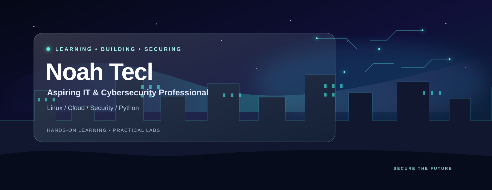

  

# Noah Tecl

Aspiring IT and cybersecurity professional building a strong foundation in operating systems, Linux, cloud computing, and programming through hands-on learning.

## Certifications & Projects

Organized as a learning journey—from the broad credential through core security skills and hands-on practice. Open any document to view the certificate.

| Order | Certificate / project | Focus | PDF |
|:--:|---|---|:--:|
| 1 | Google Cybersecurity Certificate | Cybersecurity professional certificate | [View certificate](Coursera%20google%20certificate.pdf) |
| 2 | Assets & Threats | Security assets and threats | [View certificate](Coursera%20asset,%20threats%205.pdf) |
| 3 | Network Security | Networks | [View certificate](Coursera%20network.pdf) |
| 4 | Linux & SQL | Linux and SQL tools | [View certificate](Coursera%20linux%20and%20sql.pdf) |
| 5 | Python | Python | [View certificate](Coursera%20python.pdf) |
| 6 | Detection & Response | Security detection and incident response | [View certificate](Coursera%20detection%20and%20response.pdf) |
| 7 | SIEM & Playbooks | SIEM workflows and playbooks | [View certificate](Coursera%20SIEM%20and%20PLAYBOOK.pdf) |
| 8 | SQL Project | Applied SQL | [View project certificate](Coursera%20sql%20project.pdf) |
| 9 | Additional Coursera Certificate | Certificate ID: 4NU2J20OPCGH | [View certificate](Coursera%204NU2J20OPCGH.pdf) |

## TryHackMe — Completed Rooms

| Area | Room | What I learned |
|---|---|---|
| Cloud | [Cloud Computing Fundamentals](https://tryhackme.com/room/cloudcomputingfundamentals) | Cloud computing concepts and how cloud services support business growth and scalability. |
| Operating Systems | [Operating Systems: Introduction](https://tryhackme.com/room/operatingsystemsintroduction) | OS fundamentals and the core features that power computers. |
| Operating Systems | [Windows Basics](https://tryhackme.com/room/windowsbasics) | Windows navigation, file management, and essential system tools. |
| Security | [Operating System Security](https://tryhackme.com/room/operatingsystemsecurity) | OS security concepts and SSH authentication on Linux. |
| Linux | [Linux CLI Basics](https://tryhackme.com/room/linuxclibasics) | Navigating the Linux command-line interface. |
| Computing Fundamentals | [Data Representation](https://tryhackme.com/room/datarepresentation) | How computers represent numbers and colors. |
| Programming | [Python: Simple Demo](https://tryhackme.com/room/pythonsimpledemo) | The structure of a basic Python program. |

## Areas of Focus

- Operating system fundamentals and security
- Windows and Linux command-line basics
- Cloud computing concepts
- Data representation and Python fundamentals
- Cybersecurity analysis, detection, and response

---

*Continuously learning through hands-on labs, practical exercises, and new certifications.*
